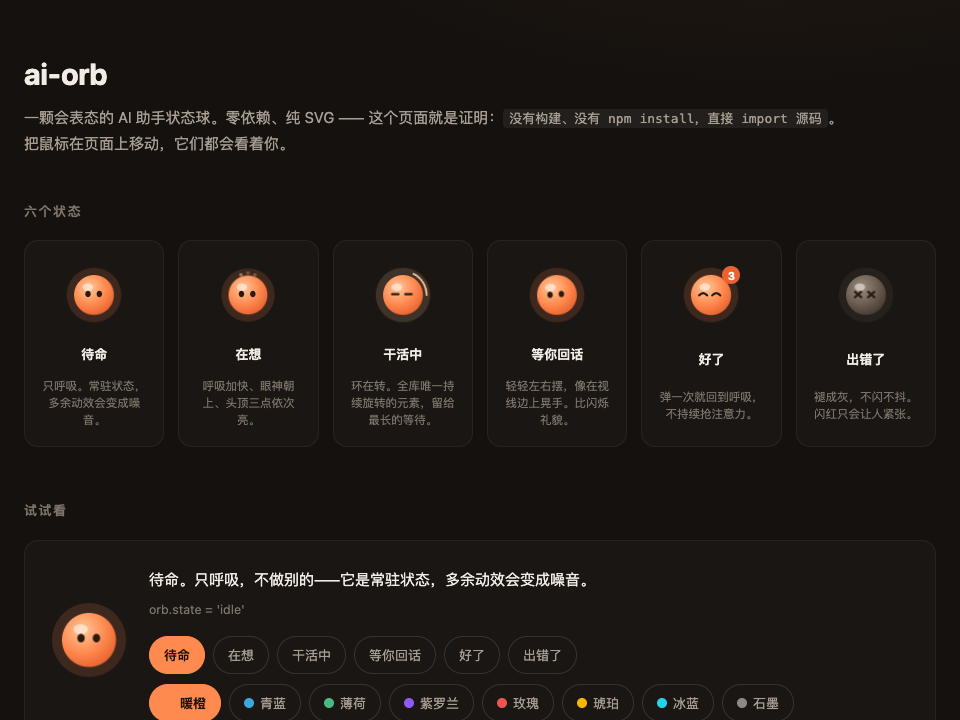

<h1 align="center">🔮 ai-orb</h1>

<p align="center">
  <strong>一颗会表态的 AI 助手状态球。</strong><br>
  在想 · 干活中 · 等你回话 · 好了。零依赖，4 KB。
</p>

<p align="center">
  
  
  
  
  
  
</p>

<p align="center">
  <a href="https://webkubor.github.io/ai-orb/"><strong>▶ 在线 Demo</strong></a> ·
  <a href="./README.en.md">English</a>
</p>

---

## 看一眼就知道它在干嘛

<p align="center">
  
</p>

| 状态 | 什么时候亮 | 表现 |
|---|---|---|
| `idle` | 默认 | 缓慢呼吸，常驻 |
| `thinking` | 请求发了，还没吐字 | 呼吸加快，眼神朝上，头顶三点闪 |
| `working` | 长任务（出图、工具调用） | 一条环在转，唯一持续旋转的元素 |
| `asking` | 助手问了话，卡在你这儿 | 轻轻左右摆，像在你视线边上晃手 |
| `done` | 结果出来了 | 弹一下、笑眼、角标 |
| `error` | 请求失败 | 褪成灰，不闪红 |

## 八色主题

```js
new AgentOrb(el, { theme: 'blue' })  // 创建时选
orb.theme = 'violet'                  // 运行时秒切
```

| 🟠 orange | 🔵 blue | 🟢 green | 🟣 violet | 🔴 rose | 🟡 gold | 🩵 cyan | ⚫ graphite |
|---|---|---|---|---|---|---|---|
| 默认 | `#3aa8d8` | `#4cb782` | `#8b5cf6` | `#ef5350` | `#f5b800` | `#22d3ee` | `#8a8a8a` |

## 三种形态

```js
new AgentOrb(el, { shape: 'squircle' })  // 圆角方块
new AgentOrb(el, { shape: 'pill' })      // 胶囊
```

| `circle` | `squircle` | `pill` |
|---|---|---|
| 圆球（默认） | 圆角方块 | 胶囊 |

形态只在创建时读取。想动态换？`destroy()` 再 `new` 一个。

## 30 秒上手

```bash
npm i ai-orb
```

```js
import { AgentOrb } from 'ai-orb'

const orb = new AgentOrb(document.querySelector('#orb'), { theme: 'blue' })

orb.state = 'thinking'   // 模型在想
orb.state = 'working'    // 长任务跑着，环在转
orb.theme = 'violet'     // 运行时换色
orb.set('done', 3)       // 好了，角标 3
orb.destroy()            // 卸载时记得清理
```

Vue 3：

```vue
<script setup>
import { AgentOrb } from 'ai-orb/vue'
</script>

<template>
  <AgentOrb :state="state" :unseen="n" :theme="theme" @click="openChat" />
</template>
```

API 就这些。

## 🎨 换肤

主题底层是 CSS 变量，要细调的话在元素上覆盖：

```css
.agent-orb {
  --ao-size: 64px;
  --ao-hi:   #a5e9ff;   /* 内高光 */
  --ao-mid:  #3aa8d8;   /* 球身   */
  --ao-lo:   #1c6a94;   /* 外缘   */
  --ao-glow: #3aa8d8;   /* 光晕   */
  --ao-ink:  #0d2733;   /* 眼睛   */
}
```

| 变量 | 默认值 | 作用 |
| --- | --- | --- |
| `--ao-size` | `56px` | 整体尺寸 |
| `--ao-hi` / `--ao-mid` / `--ao-lo` | 暖橙 | 径向渐变，由内到外 |
| `--ao-glow` | `#ff8a50` | 光晕色（各状态会覆盖） |
| `--ao-ink` | `#2a1a10` | 眼睛颜色 |
| `--ao-badge-bg` / `--ao-badge-fg` / `--ao-badge-ring` | — | 未读角标 |

## 📖 API

### `new AgentOrb(host, options?)`

`host` 是挂载点 —— 球会**追加**进去，不会替换掉它本身。
`host` 为空时直接抛错（静默失败会被当成样式问题查半天）。

| 参数 | 类型 | 默认 | 说明 |
| --- | --- | --- | --- |
| `state` | `OrbState` | `'idle'` | 未知值回落到 `idle` |
| `unseen` | `number` | `0` | 仅 `state === 'done'` 且 `> 0` 时显示角标 |
| `size` | `number \| string` | — | 数字按 px 处理 |
| `follow` | `boolean` | `true` | 眼睛跟随光标 |
| `blink` | `boolean` | `true` | 眨眼 |
| `shape` | `string` | `'circle'` | 外形：`circle` / `squircle` / `pill` |
| `theme` | `string \| null` | `null` | 内置主题名（见上表） |
| `labels` | `object` | 英文 | 覆盖 `aria-label` 文案，做多语言用 |
| `onClick` | `function` | — | 点击回调 |

**实例：** `orb.state`、`orb.unseen`、`orb.theme`（都可写）、`orb.set(state, unseen?)`、
`orb.destroy()`、`orb.el`（那个 button，用它设 CSS 变量）。

**另外导出：** `STATES`、`DEFAULT_LABELS`、`SHAPES`、`THEMES`、`css`、`injectStyle(doc?)`。

样式每页自动注入一次。要自己管样式（SSR、严格 CSP、自定义主题流水线）就
改成引入 `css` 字符串。

## 设计上的三条克制

都是有意为之，不是还没做完：

1. **只有六个状态。** 56px 下分不清的状态再多也没用，不如少而清楚。
2. **只有一样东西在转。** 环只留给 `working`——最长的那段等待。
   什么都在动，就等于什么都不紧急。
3. **不做卡通脸。** 它得能待在正经产品的角落里，而不是变成屏幕上最吵的东西。

同页多颗球共用一个 `mousemove` 监听和一个 `requestAnimationFrame` 循环，
最后一个 `destroy()` 时一起摘掉。渐变 id 按实例区分——共用 id 的话，
销毁第一颗会让其余的全变成空心圈。

## 本地开发

```bash
git clone https://github.com/webkubor/ai-orb
cd ai-orb
npm install
npm test

npx serve .   # 然后开 http://localhost:3000/demo/
```

demo 直接 import 源码，没有构建步骤。但**必须经 http 打开**：
ES module 在 `file://` 下会被 CORS 拦掉，表现是「页面出来了但一颗球都没有」。

## 谁在用

- [MUSE AV](https://www.museav.top) —— AI 出图工作台。这颗球是它创作助手的收起态，
  那里出一张图经常要 30–90 秒。

你也在用？欢迎提 PR 加上。

## License

MIT © [webkubor](https://github.com/webkubor)
